# TA Case Test Agent

面向基金销售与 TA 文件交换测试的 Agent 工作台。通过自然语言讨论测试目标，整理可编辑的测试方案，确认准备数据与预期结果，生成申请文件包，再根据 TA 回传核对实际业务结果。

平台以项目组织多个 Case，支持不同条件、字段、对比数量和独立的非对比任务。基金、费率、日期与场景来自当前 Case；协议校验由代码负责，业务规则和预期由用户提供或与 AI 讨论确定。

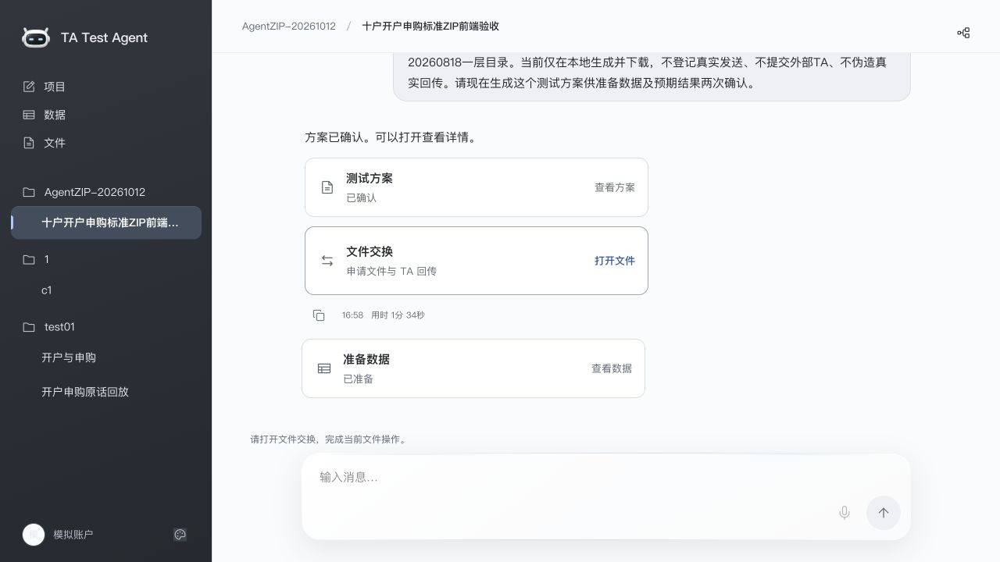

> 截图于 2026-10-13 从本地 Agent 平台实际截取，来自已有合成验收 Case。客户、金额、净值与日期仅用于测试；文件已生成不表示已提交外部 TA，预期成功不表示已收到成功回传。截图对应平台基线 `120ae343`，不代表其他分支或远端 main 已包含全部功能。

## 阅读导航

- [主要能力](#主要能力)
- [界面与操作](#界面与操作)
- [TA 文件链路](#ta-文件链路)
- [Agent 架构](#agent-架构)
- [本地运行](#本地运行)
- [验证与能力边界](#验证与能力边界)
- [进一步阅读](#进一步阅读)

## 主要能力

| 能力 | 当前行为 |
| --- | --- |
| 需求讨论 | 承接当前 Case 历史与已知条件，讨论目标、准备条件、业务预期和文件安排；缺少业务日期时主动询问 |
| 方案生成与修改 | 通过自然语言整理、修改方案，也可手动编辑；区分当前方案和保留的历史内容 |
| 两次明确确认 | 先确认准备数据，再确认预期结果；普通聊天认可不代替点击确认 |
| 数据准备 | 按确认定义准备客户、账户、基金与模拟持有，校验生成内容与确认定义一致 |
| 文件交付 | 按通道协议与配置生成原始申请、索引和 ZIP，支持符合条件的同项目多 Case 合批 |
| 回传处理 | 解析 02/04/05 原始回传与完整索引，保留原始字节及来源；解析与正式同步分开 |
| 结果核对 | 收集方案、申请、回传和正式数据证据，形成建议，由用户确认最终结论 |
| 检索与恢复 | 数据和文件搜索、筛选、排序；LangGraph 结合 MySQL checkpoint 恢复等待阶段 |
| 工作台交互 | 项目与 Case 双击/F2 改名、侧栏宽度调整、独立滚动、回到最新消息、四个外观 |

## 界面与操作

### 1. 从对话进入方案

在项目中建立 Case，描述目标、已知条件与预期。信息未完整时可继续讨论；明确要求生成方案后，从聊天卡片打开详情。方案、准备数据与文件交换分别提供入口。

方案详情分为“方案内容”“准备数据”“文件安排”。共同条件集中展示，各情况呈现差异与预期，较长的条件、操作和依据按需展开。

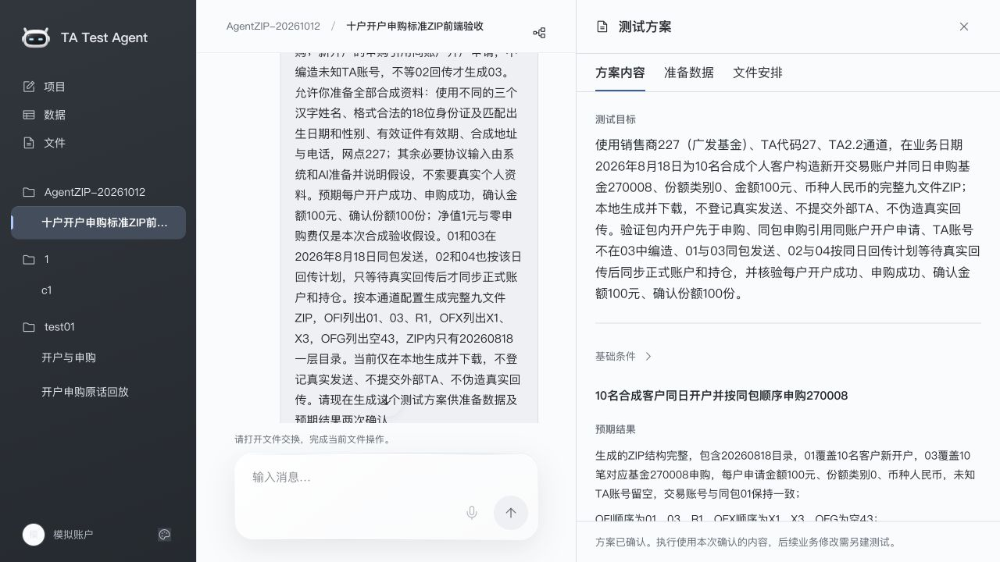

### 2. 修改方案与两次确认

确认前可以直接说“把申请金额改为……”“保留输入，只修改预期……”，也可以手动修改准备条件、操作、预期结果和核对依据。

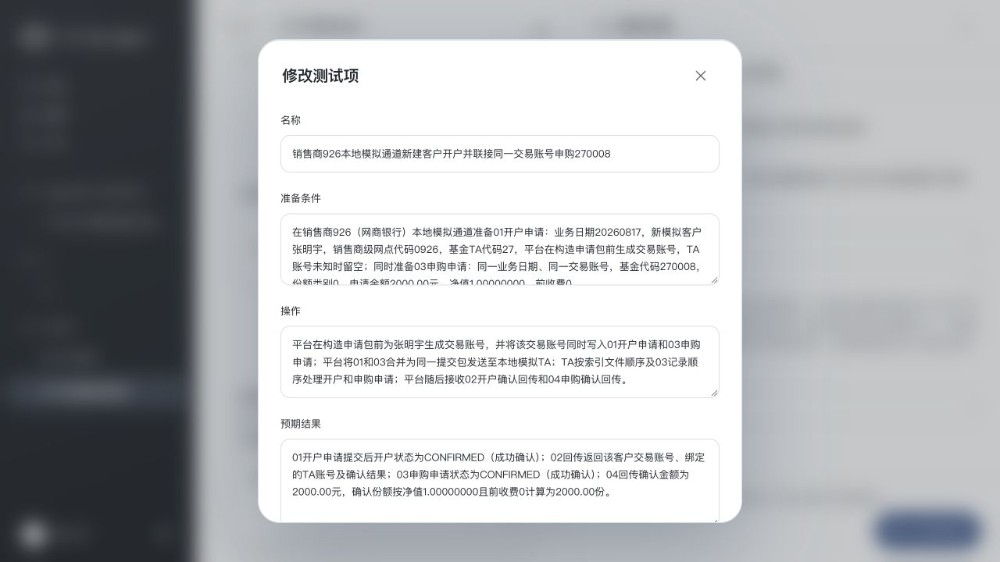

底部确认区依次要求“确认准备数据”和“确认预期结果”。仅修改预期且其他执行条件完全不变时可沿用数据确认；输入或操作变化需要重新确认。执行开始后保留已确认内容和原始申请，后续业务修改另建测试记录。

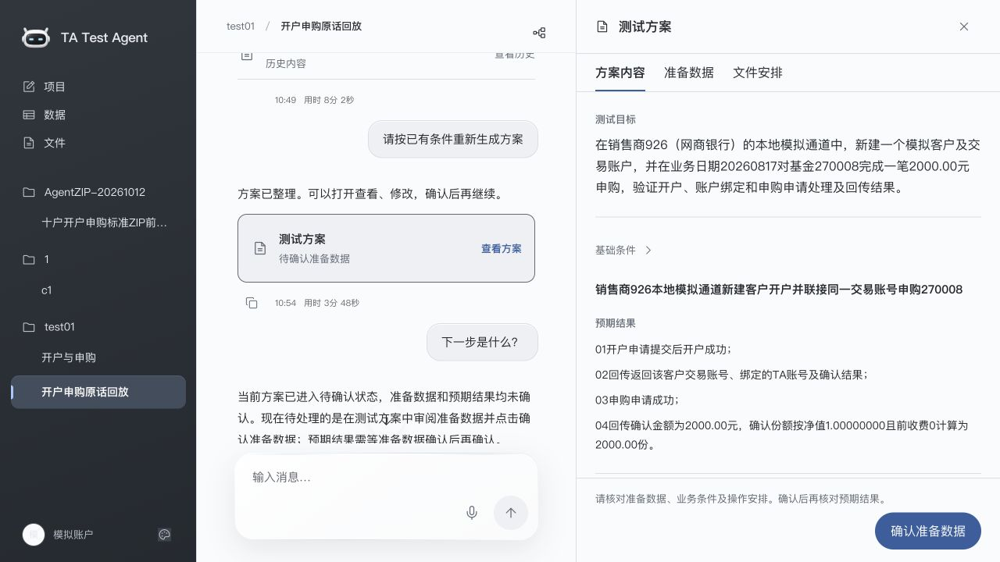

### 3. 查看准备数据

双确认后，系统准备数据并校验；失败或不一致时停留在可重试状态。新流程不再增加第三次草稿确认，旧已锁定方案保留原流程。

客户、账户、基金、模拟持有分区展示。这些数据用于构造测试申请，正式账户和持仓以已确认并同步的 TA 回传为准。

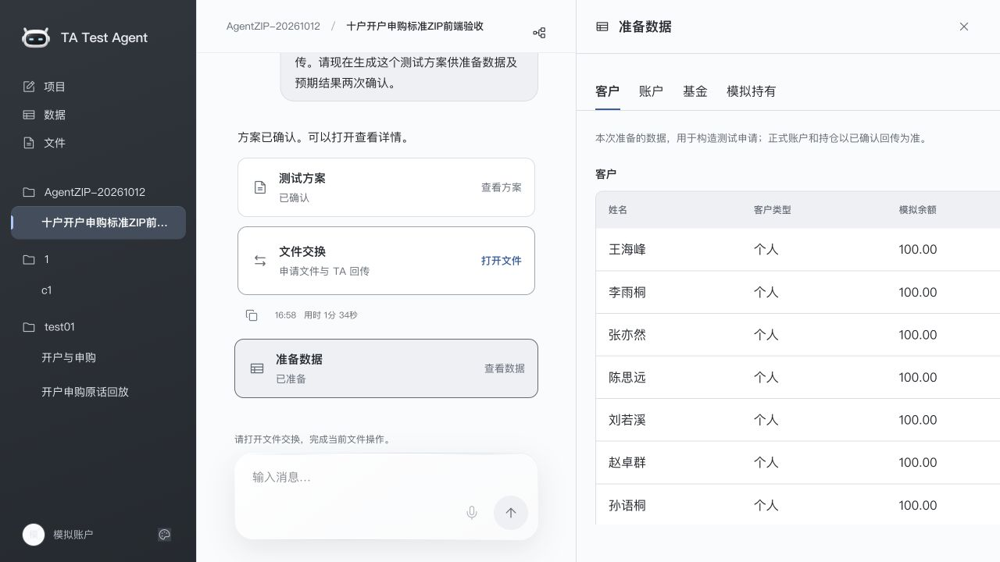

### 4. 查看业务操作与文件安排

文件安排展示中文业务动作、日期、账户、基金和前置条件。包内开户先于交易，与等待外部回传分别记录；真实不同日期或依赖未来结果的操作须分别规划提交包。

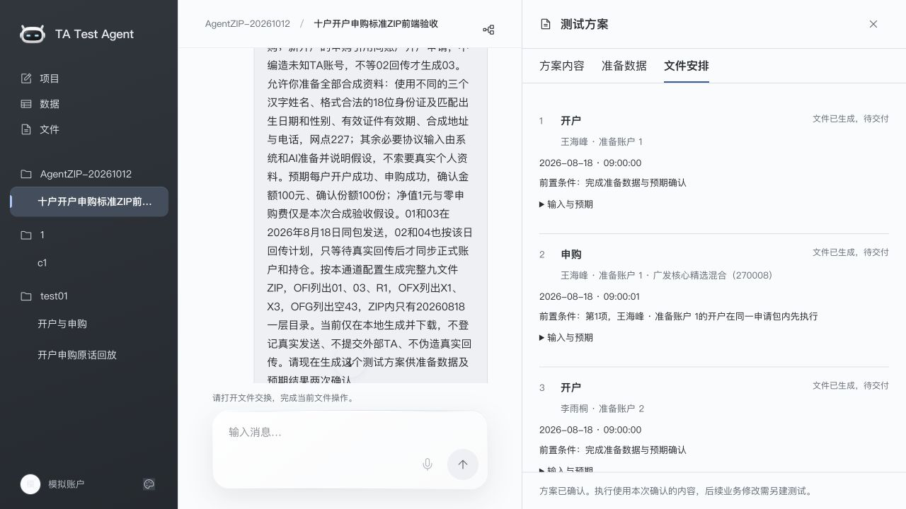

### 5. 下载申请包

“申请文件”分区提供通道选择、原始申请文件和完整 ZIP 下载。交付包采用通道实际配置，不能以单个 TXT 代替完整交付包。

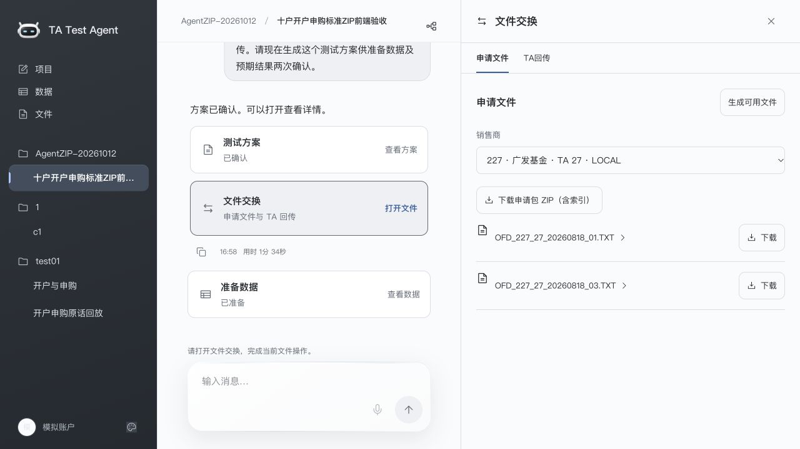

### 6. 接收 TA 回传

完成外部交付后再登记“已交给 TA”。回传区按计划和已生成申请提供上传入口；解析成功后还须核验和同步，才形成正式业务数据。图中未交付的 Case 仍处于等待状态。

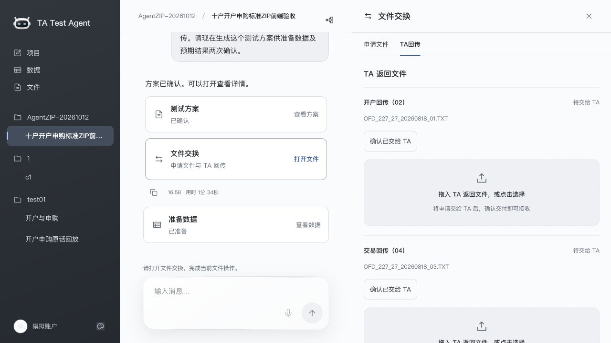

### 7. 流程与文件检索

流程图按实际状态标明已通过、当前节点和后续路径。下面的 Case 已生成 ZIP，仍等待提交与回传，结果核对未执行。

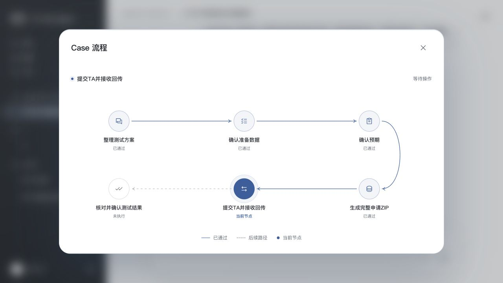

全局文件页支持按类型、方向、销售商、业务日期、项目等检索，并查看同批申请、详情和下载原件。

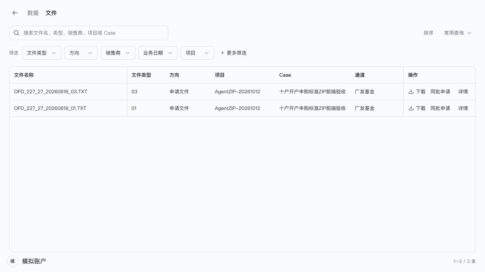

## TA 文件链路

默认模拟数据构造走 TA 文件链路。同一项目、同通道、同业务日期且依赖相容的申请按文件类型合批，保留各账户记录与各自预期。

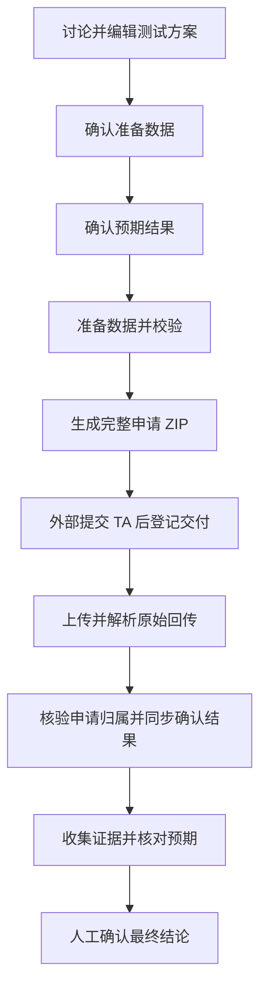

| 文件 | 用途 | 关键约束 |
| --- | --- | --- |
| 01 | 账户申请 | 保留身份和交易账号引用 |
| 03 | 交易申请 | 可与同账户 01 同包；未知 TA 账号留空，按协议条件精确引用开户原申请 |
| OFI | 申请索引 | 列明文件及顺序，同包 01 在 03 之前 |
| 02 | 账户结果 | 成功匹配并明确同步后才建立正式账户与 TA 绑定 |
| 04 | 交易结果 | 核验申请与账户关系后按实际确认值同步，不以申请值冒充确认值 |
| 05 | 持仓回传 | 按 Case 核对需要安排，核验后同步快照 |

符合条件的新开户和交易一次生成完整 01/03 与 OFI，作为一个 ZIP 提交，无需等待 02 才生成同包 03。成功 04 同步仍须具备对应成功 02 的正式账户绑定。已有正式账户可按方案直接准备 03；历史已确认分轮方案保留原语义。

部分通道还需要 R1、X1、X3、OFX、空 43 与 OFG。九文件交付属于通道配置，其他通道不强制使用；空 43 支持不等同于非空合同签署。详见[九文件验收](docs/Agent九文件全链路验收.md)。

**生成、交付登记、解析、业务同步与最终判定分别保存状态。** 协议合法但业务失败的回传保留真实失败。完整混合 02/04/05 回传由统一入口接收，原始 OFI 与其声明的数据文件须完整保留；当前接收原始文件，不支持直接上传回传 ZIP。

## Agent 架构

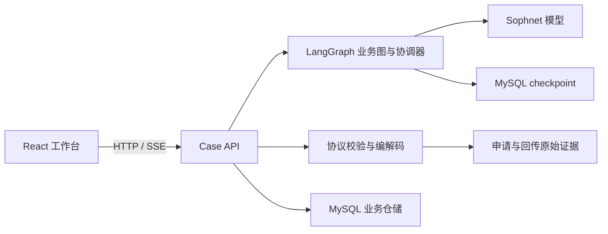

| 目录 | 职责 |
| --- | --- |
| `Frontend/` | React 工作台、方案审阅与编辑、数据/文件/结果页面、外观和响应式布局 |
| `Backend/packages/case-api/` | 登录会话、HTTP/SSE 接口、项目合批和业务服务编排 |
| `Backend/packages/case-agent/` | 讨论、方案、数据生成、结果核对等 LangGraph 图及 Sophnet 调用 |
| `Backend/packages/platform-protocol/` | 协议定义、结构校验、编解码与索引规则 |
| `Backend/packages/platform-store/` | MySQL 仓储、事务、迁移、确认审计、原件与耐久等待 |
| `Backend/legacy/` | 历史兼容服务及依赖，按需要独立运行 |
| `docs/`、`Backend/docs/` | 设计、接口、专题实现和验收记录 |

主业务模型为 **Sophnet `DeepSeek-V4-Pro-0813`**，通过 OpenAI 兼容端点 `https://www.sophnet.com/api/open-apis/v1` 调用。业务准入和图片理解另有模型配置，见服务端源码；主模型验收口径不变。

模型基于上下文整理方案与解释预期；后端负责协议、归属、时序、事务、幂等与精确数值比较。模型建议不会直接成为正式账户、持仓或人工最终结论。业务 API 完成操作后，协调器重新读取已提交事实，通过 checkpoint/interrupt 恢复等待，客户端不能自行声明阶段成功。

## 本地运行

### 环境与版本

使用 Node.js 24、pnpm 11.25.0 和可访问的 MySQL，前后端独立安装依赖。先确认分支包含所需功能；本机开发还须核对[版本索引](PROJECT_VERSION_GUIDE.md)和实时 Git 状态。索引保留历史，不应直接使用其中旧端口或分支。

```sh
git clone https://github.com/yqsota666/TA-case-test-Agent.git
cd TA-case-test-Agent
pnpm --dir Backend install --frozen-lockfile
pnpm --dir Frontend install --frozen-lockfile
```

### 后端

先创建独立数据库及账号。数据库名须符合 `ta_case_agent` 或 `ta_case_agent_<小写字母数字>`，例如 `ta_case_agent_dev`。迁移命令不负责创建数据库或完整业务通道配置。

| 环境变量 | 说明 |
| --- | --- |
| `CASE_DB_HOST` / `CASE_DB_PORT` | MySQL 地址，默认 `127.0.0.1:3306` |
| `CASE_DB_USER` / `CASE_DB_PASSWORD` | 数据库账号与密码，必填 |
| `CASE_DB_NAME` | 独立数据库名称，必填 |
| `CASE_API_PORT` | API 端口，以下示例使用 `3106` |
| `CASE_PUBLIC_ORIGIN` | 允许的 API Origin，示例为 `http://127.0.0.1:3106` |
| `SOPHNET_API_KEY` | Sophnet 密钥，通过进程环境注入 |

安全配置数据库凭据和模型密钥后运行；不要将实际凭据写入仓库或命令日志：

```sh
export CASE_DB_HOST=127.0.0.1
export CASE_DB_PORT=3306
export CASE_DB_NAME=ta_case_agent_dev
export CASE_API_PORT=3106
export CASE_PUBLIC_ORIGIN=http://127.0.0.1:3106
pnpm --dir Backend db:migrate
pnpm --dir Backend start:case-api
```

本项目 macOS 验收密钥存于钥匙串 service `codex.sophnet.ta-case-test-agent`、account `api-key`，读取后只通过进程环境传入，不打印或落盘。其他机器须提供自己的凭据。真实模型测试先检查密钥可读性，不可用时明确报告未做真实模型测试。

### 前端

另开终端，显式配置端口与 API 代理目标，避免使用历史默认值：

```sh
FRONTEND_PORT=5199 CASE_API_TARGET=http://127.0.0.1:3106 \
  pnpm --dir Frontend exec vite --host 127.0.0.1 --port 5199 --strictPort
```

打开[本地工作台](http://127.0.0.1:5199/)，注册或登录后配置销售商、协议和 TA 通道。演示登录仅在服务端允许的本地数据库配置下提供，不是所有部署都存在的默认账号；截图数据不会随 Git 克隆出现。

若已有验收服务占用示例端口，选用空闲端口并同步调整代理。前端 `/live-api` 代理到 Case API `/api`，Vite 仅转换允许的本地来源 Origin。历史兼容服务的独立安装与运行见 [Backend README](Backend/README.md#兼容服务)。

## 验证与能力边界

```sh
pnpm --dir Backend test
pnpm --dir Frontend build
```

后端测试覆盖 Agent、API、存储与协议。真实 MySQL 专项需独立测试数据库和显式开关，默认跳过不等于通过。前端单元与浏览器专项位于 `Frontend/test/`、`Frontend/src/*.test.js` 和 `Frontend/scripts/`。

此前本地验收覆盖真实 Sophnet 方案输出、双确认、多 Case 同包 ZIP 下载解析、1/3/10 户与不同通道、合成 02/04 同步、幂等和事务回滚。具体结果及既有失败见专题记录，历史通过不代表任何分支当前都通过。本轮文档更新只读取已有页面并截取截图，未重新调用模型、确认方案、生成文件或同步业务。

当前边界：

- 外部 TA 提交与物理重置由操作者在外部完成；平台登记声明和接收原件，不声称已完成真实 TA 网络传输。
- 正式业务入账以已实现的开户、申购确认与持仓回传路径为依据；其他业务的协议准备、解析与账务效果须分别核对，不能因协议包含业务码就宣称完整支持。
- 回传 ZIP、跨通道多轮自动路由、交易日历与秒级定时不属于当前完整支持范围。
- 自由文本业务规则的完整语义仍需人工审阅；证据缺失、回传失败或模型异常不能显示虚假成功。
- 合成回传验收不代表 Agent 输出已在外部目标 TA 实际导入通过。

## 进一步阅读

| 文档 | 内容 |
| --- | --- |
| [方案持续修改](docs/测试方案持续修改.md) | 对话/手动编辑、双确认与旧流程兼容 |
| [聊天产物详情](docs/聊天卡片调整.md) | 方案、数据、文件和结果页面组织 |
| [一次提交申请包](docs/一次提交申请包设计.md) | 01/03 同包与依赖处理 |
| [统一 TA 回传](docs/统一TA回传接收.md) | 原始 02/04/05 混合包契约 |
| [耐久编排](Backend/docs/durable-workflow.md) | checkpoint、interrupt、对账与恢复 |
| [结果核对](Backend/docs/business-result-review.md) | 证据、精确比较及人工最终确认 |
| [九文件验收](docs/Agent九文件全链路验收.md) | 通道包、真实模型和合成回传的验收范围 |
| [数据与文件搜索](docs/数据与文件搜索筛选.md) | 检索、筛选与排序 |
| [业务日期询问](docs/缺少日期时主动询问.md) | 日期主动询问及已知条件承接 |
| [截图来源](docs/images/agent/README.md) | 截图清单与状态说明 |

专题记录保留当时版本与验收背景。涉及旧分轮流程、额外草稿确认和历史界面时，以当前代码、本文及更新日期较新的专题记录为准。独立的模拟销售＋模拟 TA 动画 Demo 属于另一产品方向，不作为此 Agent 平台默认入口。
